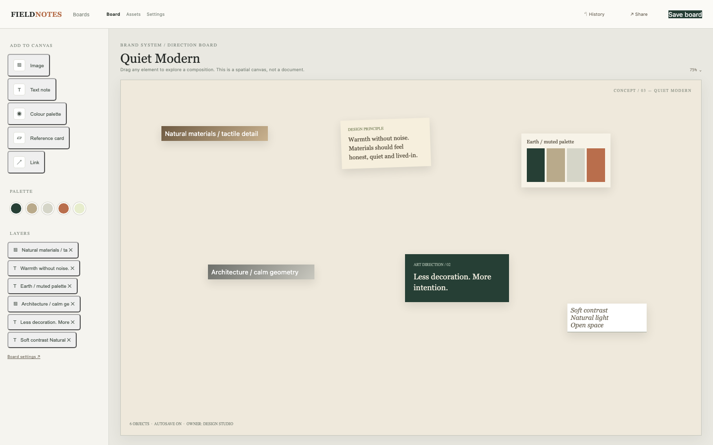

# Moodboard

A freeform design board: reference images, notes, colour palettes and text placed as draggable objects on a project canvas.

## Run it

```sh
npm install
npm start
```

Open the address it prints. `npm test` runs the tests (node:test; no network, no key).

## What to ask the chat next

- Drag the direction note to a new spot and reload to see the saved position.
- Add a colour palette object and edit its text in the board settings.
- Remove an object with the layers list and save the board.

## Screenshot


